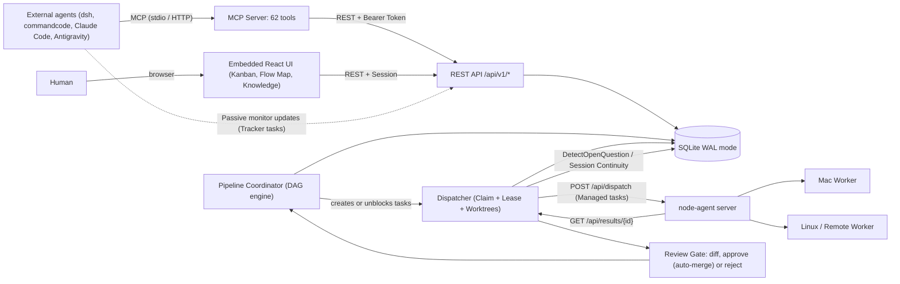

# switchyard-lite

Standalone agent task control plane — Kanban board, single dispatcher with atomic claim/leases, review gate with per-task git worktrees, interactive open questions with session continuity, dual task execution modes (managed vs passive tracker), 62 MCP tools with full control-plane parity, a 3-column Knowledge Center, and a deterministic autonomous pipeline engine (`design-thinking` + `meta7`).

Zero dependency on Hermes. Connects directly to your existing **[node-agent](https://github.com/adityahimaone/node-agent)** workers using the unchanged `POST /api/dispatch` and `GET /api/results/{id}` wire contract.

---

## Architecture



---

## Key Features

1. **Dual Task Execution Modes (`managed` vs `tracker`)**:
   - `managed` *(Default)*: Atomic lease claims, per-task git worktree (`sy/<task-id>`), worker dispatch via `node-agent`, automatic failure detection, and explicit `retry_task` / `POST /api/v1/tasks/{id}/retry`.
   - `tracker` *(Passive Monitor-Only)*: Skipped cleanly by the background dispatcher (`Tick` & `Claim`). External agents running in `dsh`, `commandcode`, or Antigravity mirror live progress, agent steps, and final completion into cards via MCP without triggering duplicate runs.
2. **Interactive Open Questions & Grill-Me on Kanban Cards**:
   - Structured decision prompts and choices captured via explicit MCP tool (`ask_task_question`) or automatic worker output parsing (`DetectOpenQuestion` matching fenced JSON, `[QUESTION]` tags, or natural numbered choices).
   - Clickable option pills rendered **inline directly on Kanban cards** and inside the Task Drawer/Page.
   - **Session Continuity**: Selecting an answer automatically records the decision and resumes `managed` tasks in `dsh` or `commandcode` by forwarding `session_continuation: true`, `dsh_session_id`, and `commandcode_session_id`.
3. **62 MCP Tools with Complete Control-Plane Parity**:
   - Full control over boards, tasks, attachments, passive tracker mirroring, retries, live logs/runs, git worktrees, review settings, pipelines/`meta7`, workspaces/skills, workers, flow map, server logs, and knowledge docs.
   - Available via both standard **stdio** and **Streamable HTTP** at `/mcp` with token scopes (`read`, `write`, `admin`).
4. **Hybrid 3-Column Knowledge / Docs Center (`#/knowledge`)**:
   - Comprehensive built-in guides (Control Plane architecture, dual modes, Grill-Me Q&A, `meta7`, Flow Map, 62 MCP tools reference, and Review Gate).
   - SQLite-backed custom articles (`knowledge_docs`) editable through both the web UI and MCP (`list_knowledge`, `get_knowledge`, `upsert_knowledge`, `delete_knowledge`).
5. **Global Flow Map & Live Ping Telemetry (`/api/v1/flow/active`)**:
   - Real-time visual topology across all boards showing active executions, recent transitions, pipelines, workspaces, and worker nodes.
   - Low-overhead EKG ping status for local and remote workspaces.
6. **Autonomous Design-Thinking & `meta7` Pipeline Engine**:
   - Deterministic multi-stage DAG workflows built on `design-thinking.yaml` and `meta7.yaml` (`explore` → `cross_examine` → `synthesize` → `design` → `verify` → `review` → `impl` + `gate_band`).

---

## Quick Start

### 1. Build and Run

```bash
# Build single binary (bundles web UI into internal/webui/dist)
make build

# Create an admin API token for agents / MCP
./bin/switchyard-lite token create --name admin --scope admin

# Start the control plane on :8790
SWITCHYARD_ADMIN_PASSWORD=secret \
NODE_AGENT_URL=http://127.0.0.1:8788 \
NODE_AGENT_TOKEN=your-node-agent-token \
./bin/switchyard-lite serve --addr :8790 --db switchyard-lite.db
```

Access the web interface at **`http://localhost:8790`**.

---

## Dual Task Execution Modes

| Feature | `managed` Mode (Default) | `tracker` Mode (Passive Monitor) |
|---|---|---|
| **Dispatcher Lifecycle** | Claimed and dispatched by `switchyard-lite` | Skipped by background dispatcher (`Tick` & `Claim`) |
| **Worker Execution** | Run on `node-agent` with worktree isolation | Executed externally by `dsh`, `commandcode`, Antigravity, etc. |
| **Status Updates** | Managed state machine (Review gate before Done) | Direct updates via `complete_tracked_task` / `report_task_progress` |
| **Retry Support** | `retry_task` / `POST /tasks/{id}/retry` re-queues & dispatches | External caller drives retry lifecycle |
| **Kanban UI Badge** | None (standard card lifecycle) | `monitor` badge |

### Passive Tracker Example (MCP)

When running work directly inside an external harness (e.g., `dsh` or `commandcode`), mirror the session on the board:

```json
// 1. Create monitor card
start_tracked_task: {
  "board_id": "default",
  "title": "Refactor auth middleware",
  "executor": "dsh",
  "session_id": "dsh_sess_123"
}

// 2. Stream incremental progress & logs
report_task_progress: {
  "id": "t_...",
  "step": "Migrating token verification",
  "percent": 50,
  "comment": true
}

// 3. Mark completed
complete_tracked_task: {
  "id": "t_...",
  "status": "done",
  "output": "All auth tests pass."
}
```

---

## Open Questions & Grill-Me on Kanban Cards

When agents need human decisions mid-task, Switchyard captures them and presents interactive pills directly on Kanban cards:

1. **Posing Questions**:
   - **Explicit MCP**: Call `ask_task_question` with `{ id, question, options: ["Option A", "Option B"], multi_select: false }`.
   - **Auto-Detection**: The dispatcher automatically detects question blocks in worker output:
     ```markdown
     ```question
     {
       "question": "Which database engine should we target?",
       "options": ["SQLite WAL", "PostgreSQL", "Embedded DuckDB"]
     }
     ```
     ```
     *(Also supports `[QUESTION]...[/QUESTION]` tags and trailing numbered/lettered choice patterns)*.
2. **Answering & Auto-Resume**:
   - Click an option pill directly on the Kanban card (or submit a custom reply in the Task Drawer).
   - Answering a `managed` task records the decision and invokes `ResumeWithAnswer`, resuming `dsh` / `commandcode` with bound session continuity (`session_continuation: true`).

---

## MCP Server Setup

Connect Claude Code, `dsh`, `commandcode`, Antigravity, or Cursor to `switchyard-lite`:

### Stdio Transport

```json
{
  "mcpServers": {
    "switchyard-lite": {
      "command": "switchyard-lite",
      "args": ["mcp"],
      "env": {
        "SWITCHYARD_URL": "http://127.0.0.1:8790",
        "SWITCHYARD_TOKEN": "syl_..."
      }
    }
  }
}
```

### Streamable HTTP Transport (`/mcp`)

```json
{
  "mcpServers": {
    "switchyard-lite": {
      "type": "http",
      "url": "http://127.0.0.1:8790/mcp",
      "headers": {
        "Authorization": "Bearer syl_..."
      }
    }
  }
}
```

---

## Complete MCP Tools Catalog (62 Tools)

| Category | Count | Tools |
|---|:---:|---|
| **Boards** | 4 | `list_boards`, `create_board`, `update_board`, `delete_board` |
| **Tasks & Dependencies** | 8 | `list_tasks`, `get_task`, `create_task`, `update_task`, `delete_task`, `move_task`, `add_dependency`, `remove_dependency` |
| **Comments & Attachments** | 5 | `list_comments`, `add_comment`, `list_attachments`, `add_attachment`, `delete_attachment` |
| **Passive Tracker Mode** | 3 | `start_tracked_task`, `report_task_progress`, `complete_tracked_task` |
| **Managed Execution & Logs** | 5 | `dispatch_task`, `retry_task`, `get_task_logs`, `get_task_runs`, `get_task_worktree` |
| **Open Questions / Grill-Me** | 3 | `ask_task_question`, `get_task_questions`, `answer_task_question` |
| **Review Gate** | 5 | `get_diff`, `approve_task`, `reject_task`, `get_review_settings`, `set_review_settings` |
| **Pipelines & meta7** | 8 | `list_templates`, `get_default_template`, `set_default_template`, `list_pipelines`, `start_pipeline`, `get_pipeline_run`, `cancel_pipeline`, `retry_pipeline_node`, `restart_pipeline` |
| **Workspaces & Skills** | 8 | `list_workspaces`, `create_workspace`, `update_workspace`, `delete_workspace`, `sync_workspaces`, `inspect_workspace`, `search_workspace_files`, `list_skills` |
| **Workers & Models** | 4 | `list_workers`, `create_worker`, `delete_worker`, `list_models` |
| **Telemetry & Observability** | 5 | `get_flow_map`, `get_overview`, `read_logs`, `tail_events`, `list_models` |
| **Knowledge / Docs** | 4 | `list_knowledge`, `get_knowledge`, `upsert_knowledge`, `delete_knowledge` |

---

## Autonomous Design-Thinking & meta7 Pipelines

Switchyard-Lite supports deterministic DAG orchestrations via built-in templates (`design-thinking.yaml` and `meta7.yaml`):

- **7-Stage Coordinator**: `explore` → `cross_examine` → `synthesize` → `design` → `verify` → `review` → `impl` + `gate_band`.
- **Waves & Dependency Gates**: Stage $N+1$ remains blocked until all dependent nodes in stage $N$ reach `done` or `evolved`.
- **Verdict Back-Arcs**:
  - `cross_examine` (`per: explore`) `FAIL` re-runs only the paired `explore:i` and `cross_examine:i` nodes.
  - `review` `FAIL:design` loops back to `design`; `FAIL:context` appends a new `explore` node for missing context and re-runs synthesis, design, and review.
- **Append-Only Event Sourcing**: Every state transition is recorded in the `events` table (`pipeline.*`) and folded deterministically.

---

## Verification & Testing

```bash
# Static analysis (Go vet + Web TypeScript check)
make lint

# Run full test suite (Go race tests + Web Vitest suite)
make test

# Build production distribution
make build
```

---

## License

MIT
