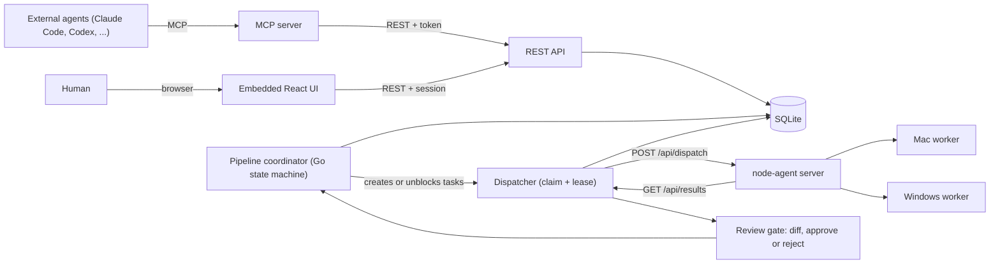

# switchyard-lite

Standalone agent task control plane — Kanban board, single dispatcher with atomic claim/leases, review gate with per-task git worktrees, MCP + REST control surface, and a deterministic design-thinking pipeline engine.

Zero dependency on Hermes. Connects directly to your existing **[node-agent](https://github.com/adityahimaone/node-agent)** workers using the unchanged `POST /api/dispatch` and `GET /api/results/{id}` wire contract.

## Architecture



## Quick Start

```bash
# Build single binary (bundles web UI into internal/webui/dist)
make build

# Create an API token for agents / CLI
./bin/switchyard-lite token create --name admin --scope admin

# Start the control plane on :8790
SWITCHYARD_ADMIN_PASSWORD=secret \
NODE_AGENT_URL=http://127.0.0.1:8788 \
NODE_AGENT_TOKEN=your-node-agent-token \
./bin/switchyard-lite serve --addr :8790 --db switchyard-lite.db
```

## MCP Server (for Claude Code, Codex, etc.)

`switchyard-lite` ships both a **stdio** MCP server and a **streamable HTTP** MCP endpoint at `/mcp`:

```bash
SWITCHYARD_URL=http://127.0.0.1:8790 \
SWITCHYARD_TOKEN=syl_... \
./bin/switchyard-lite mcp
```

### Available MCP Tools (20)

| Category | Tools |
|---|---|
| Boards & Tasks | `list_boards`, `create_board`, `list_tasks`, `get_task`, `create_task`, `update_task`, `move_task`, `add_comment`, `add_dependency`, `tail_events` |
| Dispatch & Review | `dispatch_task`, `get_diff`, `approve_task`, `reject_task`, `list_workers`, `list_models` |
| Design-Thinking Pipelines | `list_templates`, `start_pipeline`, `get_pipeline_run`, `cancel_pipeline` |

## Autonomous Design-Thinking Pipeline Engine

Adapted from `meta7`:

- **Waves & Gates**: Stages (`explore` → `cross_examine` → `synthesize` → `design` → `review` → `impl` + `gate_band` → `commit`) materialize as child tasks on the board. Stage `N+1` stays blocked until all nodes in stage `N` are `done` or `evolved`.
- **Strict Input Boundaries**: Each stage prompt receives only outputs from stages declared in its `inputs:` or `per:` pairing.
- **Retry & Evolve**: Failed nodes retry with the identical prompt. After 3 consecutive identical error signatures, the engine spawns a **Modifier** task with accumulated failure payloads to rewrite the node prompt (`evolved`).
- **Verdict Back-Arcs & Split Protocol**:
  - `cross_examine` (`per: explore`) `FAIL` re-runs only the paired `explore:i` and `cross_examine:i` nodes.
  - `review` `FAIL:design` loops back to `design`; `FAIL:context` appends a new `explore` node for missing context and re-runs synthesis, design, and review.
  - Bounded by `budget: { max_review_loops: 5, max_evolutions: 3 }` — when exhausted, the run transitions to `needs_human`.
- **Append-Only State Log**: Every pipeline state transition is recorded in the append-only `events` table (`pipeline.*`) and folded by `ProjectRun`.
