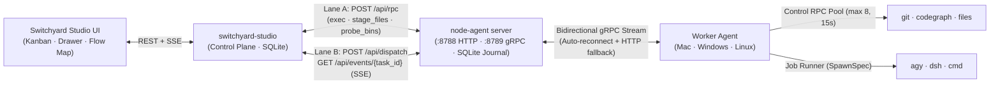

# Switchyard Autonomous Studio V2 — 3-Wave Architecture Specification

> **Status**: Wave 1 Implemented · Waves 2 & 3 Specified  
> **Repositories**: `switchyard-studio` (Control Plane + Studio UI) · `node-agent` (Harness-Agnostic Dual-Lane Transport & Worker Runtime)

---

## 1. Executive Summary

Switchyard Autonomous Studio V2 transforms `switchyard-studio` and `node-agent` from a polling-based single-lane task dispatcher into a **real-time, harness-agnostic autonomous engineering studio**.

Core architectural principles:
1. **`node-agent` is a pure transport & runtime** — it never hardcodes harness CLI flags or prompt logic; it executes generic `SpawnSpec` processes, streams stdout/stderr over gRPC/SSE, and serves non-blocking Control RPCs (`exec`, `stage_files`, `probe_bins`).
2. **Big-3 Pluggable Harnesses (`agy`, `dsh`, `commandcode`/`cmd`)** — `switchyard-studio/internal/harnesses` owns CLI argument construction, NDJSON/stream-json unwrapping, per-harness session tracking (`harness_sessions`), and cross-harness handoff summaries.
3. **First-Class Interactive `waiting_input` & Grill-Me** — open questions pause tasks in a dedicated `waiting_input` column (never `review` or `failed`) with inline recommended choices, optional mid-card model/harness switching, and an explicit `Grill-Me First` interview toggle.
4. **Phase-1 Streamlined Surface** — `Pipelines` / `meta7` / `design-thinking` are hidden from the UI by default (gated behind `switchyard.pipelines.enabled=1`) while backend routes remain intact for Phase 2.

---

## 2. System Topology



---

## 3. Rollout Waves

### Wave 1 — Foundation, Dual-Lane Transport, Big-3 Harnesses & Waiting-Input Grill-Me *(Implemented)*

#### 3.1 Phase-1 Cleanup (`meta7` / `Pipelines` Hidden)
- Feature gate `isPipelinesEnabled()` in `web/src/lib/features.ts` (`localStorage.getItem("switchyard.pipelines.enabled") === "1"` or `VITE_ENABLE_PIPELINES=1`).
- Hides `Pipelines` nav item, `Run with meta7` card menu item, `meta7` TaskDialog start mode, and renames the `meta7` Flow Map node to `Autonomous Studio`.
- Repurposes Board's `Run board (N)` button to dispatch queued `todo` (non-tracker) tasks directly.

#### 3.2 Harness-Agnostic Dual-Lane `node-agent` Transport
- **Lane A — Instant Control RPC (`POST /api/rpc`)**:
  - Executes `exec`, `stage_files`, and `probe_bins` concurrently on the worker (bounded semaphore of 8 goroutines, 15s default timeout) **without waiting behind `busy=1` AI jobs**.
  - Delivered via gRPC `ServerFrame.ControlRPC` / `WorkerFrame.ControlRPCReply`, with HTTP fallback (`GET /api/nodes/{id}/rpc/poll` & `POST /api/nodes/{id}/rpc/reply`).
- **Lane B — Job Execution & SSE Push (`SpawnSpec` + `GET /api/events/{task_id}`)**:
  - `DispatchRequest.Spawn` / `DispatchJob.Spawn` (`argv`, `env`, `cwd`, `stdin`, `timeout_s`) launches any CLI binary cleanly on macOS, Linux, and Windows (resolving npm `.cmd` shims and `PATH`).
  - Raw stdout/stderr chunks stream via gRPC `JobProgress.Chunk` (or HTTP `/api/nodes/progress`) and are pushed immediately over SSE `GET /api/events/{task_id}`.
  - gRPC worker loop auto-reconnects with exponential backoff and syncs `DSHHealth`, `ModelSummaries`, `ModelPayloads`, `Refresh`, and `WantModels` via `HeartbeatFrame` / `HeartbeatAck`.
- **SQLite Journal (`node-agent/internal/journal`)**:
  - Persists `queued_jobs`, `job_progress`, and `job_results` in `$HOME/.hermes/node-agent.db` (WAL mode) so `node-agent` server restarts never lose in-flight state.

#### 3.3 Big-3 Harnesses (`agy`, `dsh`, `commandcode`) & Mid-Card Switching
- Default UI executor order: `["agy", "dsh", "commandcode", "claude", "codex", "omp"]` with `["claude", "codex", "omp"]` hidden by default on fresh installs.
- `internal/harnesses` builds `SpawnSpec`s, unwraps NDJSON/stream-json (`agy`, `dsh`, `commandcode`, `claude`, `omp`) while preserving question blocks verbatim, and persists per-harness session IDs in `tasks.harness_sessions` (JSON map).
- **Mid-Card Switching**:
  - Switching model within the same harness resumes the bound session ID.
  - Switching across harnesses (`dsh` ↔ `cmd` ↔ `agy`) on Question Answer or Retry injects a `[CROSS-HARNESS HANDOFF]` preamble summarizing prior runs, answered questions, and `sy/<task-id>` worktree state.

#### 3.4 Grill-Me & `waiting_input` State
- New `waiting_input` status (`Waiting Input` column) in `tasks` status machine.
- `AugmentAutonomousPrompt` injects the universal structured-question protocol and, when `tasks.grill_me == true`, instructs the agent to inspect relevant files and ask one high-leverage question at a time with `(Recommended)` first option before editing.
- When `DetectOpenQuestion` matches a question in unwrapped worker output, `dispatcher.go` records the `TaskQuestion`, saves the harness session ID, and moves the task to **`waiting_input`** (instead of `review` or `failed`).
- `TaskQuestionCard` highlights `(Recommended)` options and includes an inline `Switch model/harness` selector so users can change model or harness when answering.
- Secondary Kanban columns (`backlog`, `blocked`, `failed`) auto-collapse into compact vertical rails when empty (`count === 0`) and expand automatically when populated or manually toggled.

---

### Wave 2 — Context Engine *(Planned Next Pass)*

1. **Task Attachment Staging & `⌘V` Image Paste**:
   - Stage uploaded/pasted files from `attachments` table into `.switchyard/attachments/<task-id>/` via `node-agent` `stage_files` Control RPC before spawning the harness.
   - Support `⌘V` clipboard image paste and drag-and-drop in Composer, Question Reply, and Comments.
2. **Cross-Node `SKILL.md` Discovery & Bundle Staging**:
   - Extend `internal/skills` to scan `~/.gemini/config/skills` and remote worker skill roots via Control RPC, staging selected skills into `.switchyard/skills/<name>/` for any harness.
3. **Unified MCP Registry & Per-Task Attachment**:
   - Store MCP server definitions in SQLite (`mcp_servers` table + `tasks.mcps` JSON array) and inject selected MCP configs into `agy --settings`, `commandcode`, and `dsh` runs.
4. **Deep CodeGraph Engine & Live Git Switcher**:
   - Power `@symbol` / `@file` omnibox and pre-dispatch context packs via `codegraph query` / `codegraph context` over Control RPC, with index status + 1-click `Sync` / `Rebuild` on Workspaces.
   - Add live Git branch switcher (`checkout`, `fetch`, `pull`, `create branch`) on Workspaces and fix `review.Approve()` to merge into the task's explicit `branch` (`base_branch`) target.

---

### Wave 3 — Visual Studio UX *(Planned Next Pass)*

1. **Dual-Density Per-Card Workflow Tree & Hybrid Subtasks**:
   - Compact Tech-Stack/Skills/MCP icon row + expandable tree preview on Kanban cards.
   - Interactive dot-grid Workflow Tree canvas in Task Drawer/Detail connecting Workspace/Branch → Task + Notes/Files → dispatchable child `parent_id` Subtasks & Harness Runs.
2. **Linear-Style Single-Canvas Bottom-Dock Studio Composer**:
   - Replace the 2-column `TaskDialog` rail with a unified single-canvas composer (top Workspace/Git-Branch/CodeGraph bar, rich `@file`/`$skill` + `⌘V` editor, inline Subtasks, bottom pill dock for `agy`/`dsh`/`cmd`, Model, Effort, MCPs, and `Grill-Me` toggle) plus `C` shortcut and inline column draft.
3. **Multiplexed `xterm.js` PTY Terminal & Tunneled Live Preview Browser**:
   - Multiplex interactive PTY streams over `node-agent` gRPC/WebSocket for an in-drawer `xterm.js` terminal scoped to the task worktree.
   - Tunnel remote `localhost:<port>` dev servers through `node-agent` to `/api/v1/preview/{taskId}/{port}/*` with an embedded Preview Browser pane (viewport toggle + 1-click screenshot-to-agent feedback).

---

## 4. Database Schema Additions (Wave 1)

```sql
-- switchyard-studio (tasks table)
ALTER TABLE tasks ADD COLUMN grill_me INTEGER NOT NULL DEFAULT 0;
ALTER TABLE tasks ADD COLUMN harness_sessions TEXT NOT NULL DEFAULT '{}';

-- node-agent server journal ($HOME/.hermes/node-agent.db)
CREATE TABLE IF NOT EXISTS queued_jobs (
  task_id TEXT PRIMARY KEY,
  node_id TEXT NOT NULL,
  payload_json TEXT NOT NULL,
  created_at INTEGER NOT NULL
);
CREATE TABLE IF NOT EXISTS job_progress (
  task_id TEXT PRIMARY KEY,
  base_offset INTEGER NOT NULL DEFAULT 0,
  chunk_data TEXT NOT NULL DEFAULT '',
  updated_at INTEGER NOT NULL
);
CREATE TABLE IF NOT EXISTS job_results (
  task_id TEXT PRIMARY KEY,
  payload_json TEXT NOT NULL,
  stored_at INTEGER NOT NULL
);
```
